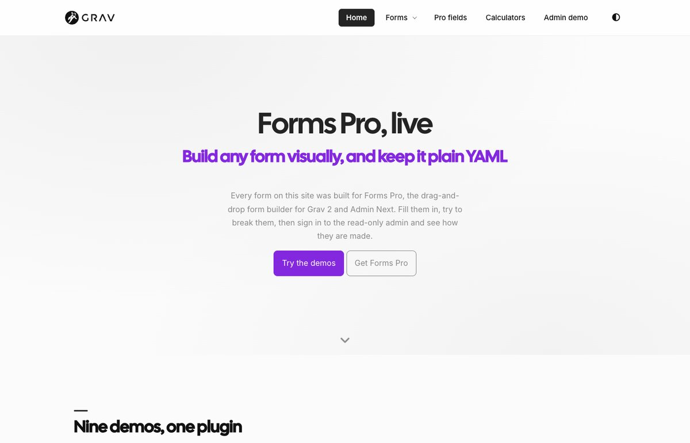

# Forms Pro Demo Skeleton

The `user/` folder behind the [Forms Pro demo](https://demo.getgrav.org/forms-pro/): contact, job application, quote, booking, feedback and spam protection forms, every Pro field, five live calculators and a read-only Admin Next to explore. It is built for [Forms Pro](https://getgrav.org/premium/forms-pro), the drag-and-drop form builder for Grav 2, on the Quark 2 theme.



Every form only shows a thank-you message. None of them stores, emails or forwards what a visitor sends, so the site is safe to put online as a demo. To keep entries, add a `submission` or `email` action to a form in the builder.

## What's inside

- `pages/`: the demo pages. Each one ends with its form's YAML in a collapsible block.
- `data/forms-pro/forms/`: the fourteen forms, one YAML file each.
- `data/forms-pro/submissions/`: fictional seed entries (all `example.com` addresses) so the Entries view has something to show.
- `config/`: site settings. The Email plugin's engine is `none`, and Forms Pro is set not to store IP addresses or browser strings.

## Installation

1. Download [Grav 2 with Admin](https://getgrav.org/download/core/grav-admin/latest) (Grav 2.2.29 or newer) and unzip it.

2. Replace the `user/` folder with the contents of this repository.

3. From the root of the site, install the free plugins and the theme:

    ```shell
    bin/gpm install form email login api admin2 flex-objects shortcode-core error problems github-markdown-alerts quark2
    ```

4. Add your Forms Pro license to the [License Manager](https://getgrav.org/premium/license-manager), then install Forms Pro:

    ```shell
    bin/gpm install forms-pro
    ```

5. Open the site's `/admin` and create your administrator account. No accounts ship with this skeleton.

The sign-in screen note and the demo login mentioned on the home and Admin demo pages belong to the hosted demo. Change them in `config/admin-next.yaml`, `pages/01.home/_admin/text.md` and `pages/05.admin-demo/default.md`.

The [Forms Pro documentation](https://learn.getgrav.org/2/grav-premium/forms-pro) covers the builder, conditional logic, calculations and everything else the demo uses.
